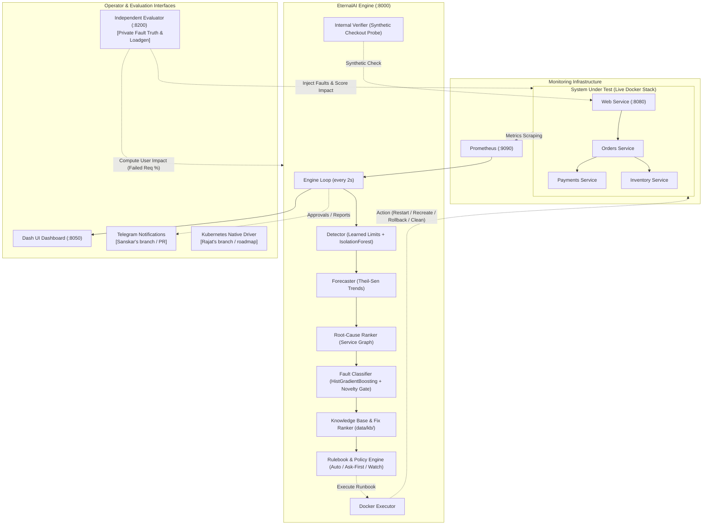

# EternalAI

An autonomous operations and predictive recovery assistant for backend microservices that detects anomalies, forecasts resource exhaustion, identifies root-cause services, executes policy-governed Docker runbooks, and verifies recovery with synthetic end-to-end checkouts.

## Headline Numbers (Current, Verified & Honest)

All numbers are produced by committed scripts from raw benchmark and test records under `docs/results/`. Read `docs/EVALUATION.md` for full methodologies and limitations.

| Metric | Result | Target / Baseline | Conditions & Scope | Source File | Status |
|---|---|---|---|---|---|
| **Disk Fill Warning Lead Time** | **86.4 s** (median) | >= 30 s | 5 warned runs [73.7s, 75.5s, 86.4s, 86.5s, 87.0s]; watch-only mode | `docs/results/forecast_check.md` | Verified live |
| **Memory Leak Warning Lead Time** | **18.3 s** (median) | >= 30 s | **FAILED TARGET**: 5 warned runs [8.1s, 9.8s, 18.3s, 19.1s, 34.5s]; steep fill slope before OOM | `docs/results/forecast_check.md` | Verified live (honest failure) |
| **Healthy-Run False Incidents** | **1 / 24** (4.2%) | <= 2 / 24 | Autopilot on fresh v2 seeds; baseline `threshold_restart` opened **6 / 24** | `docs/results/benchmark_v2.md` | Verified live |
| **Harmful Actions on Healthy Runs** | **0 / 24** (0%) | 0 / 24 | 0 actions executed in 24 autopilot and 8 ask-first healthy runs | `docs/results/benchmark_v2.md` | Verified live |
| **Supported Fault Recovery (Autopilot)** | **18 / 18** [82%, 100%] | >= 15 / 18 | 3 runs each across 6 faults; verified by internal synthetic checkout; mean failed req: 11.15% | `docs/results/benchmark_v2.md` | Verified live |
| **Supported Fault Recovery (Ask-First)** | **18 / 18** [82%, 100%] | >= 15 / 18 | Human approval mode; 0 approval failures; verified by internal checkout | `docs/results/benchmark_v2.md` | Verified live |
| **Unseen Fault Abstention (`cpu_burn`)** | **2 / 3** (66.7%) | >= 2 / 3 | Seed 426 restarted wrong service (`inventory`); now guarded by close-candidates rule | `docs/results/benchmark_v2.md`, `docs/postmortems/cpu_burn_seed426.md` | Verified live |
| **Cross-System Fault Transfer** | **56.4%** macro-F1 | ~55-60% | Train Ticket (53 real cases), HistGradientBoosting on Dataset A; balanced accuracy 58.6% | `docs/results/dataset_a_model.md` | Offline result (NOT live) |
| **Live Classifier Grouped CV** | **0.991** macro-F1 | > 0.90 | 105 runs, 33,576 windows of monitored application; ECE = 0.003; in-distribution | `docs/results/models_cv_v2.md` | Verified live model |

## Architecture



## Quick start

```
git clone https://github.com/py007105/eAI && cd eAI
cp .env.example .env            # optional: GEMINI_API_KEY / GROQ_API_KEY; set ETERNALAI_APPROVAL_TOKEN to a real secret to enable Approve/Reject
docker compose --profile releases build
docker compose up -d
```

| what | where |
|---|---|
| dashboard | http://localhost:8050 |
| EternalAI API | http://localhost:8000 (`/status`, `/incidents`, `/approvals`) |
| the shop (web service) | http://localhost:8080 |
| evaluator (fault injection and scoring) | http://localhost:8200 |
| Prometheus / Jaeger | http://localhost:9090 / http://localhost:16686 |

Requires Docker with Compose. Python 3.11+ only for running the scripts and tests outside containers. Without an LLM key every report is a deterministic template report;
the system works the same. The approve, reject and mode endpoints are refused until `ETERNALAI_APPROVAL_TOKEN` is set to something other than the placeholder.
Stop everything with `docker compose down`.

## Limitations

> **Status: benchmark v1 and the reduced v2 evaluation are finished.** Every number in this repository comes from a script you can rerun and is written to a file under `docs/results/`. Read `docs/EVALUATION.md` (methods and limitations) before any number.

> **Three findings first (benchmark v1, `docs/results/benchmark.md`; not buried, not softened):**
> 1. **The ask-first arm is invalid.** The benchmark harness handed the brain and the simulated operator the placeholder token `change-me` (an import of the config module loaded it from `.env`), so the brain refused every approval (HTTP 503) and the operator ignored the refusal; the first proposal then sat unapproved and, because a pending approval never expires, blocked all later detection (42 of 45 runs). Its 0 of 30 recoveries say nothing about ask-first operation (`docs/postmortems/ask-first-arm-stuck-incident-v1.md`). Both faults are fixed on the v2 branch and evaluated on fresh seeds.
> 2. **False alarms on healthy runs.** The autopilot opened an incident in 8 of 10 healthy runs and recreated a container in 4 of 5 traffic surges (it called a surge a memory leak). threshold_restart had 5 of 10 false alerts and prototype_rules 8 of 10 (`docs/postmortems/autopilot-healthy-runs-v1.md`).
> 3. **Recovery is self-reported.** It comes from the system's own checkout; the independent measure is the load generator's failed-request %. No independent probe logs exist.
>
> Also true: the benchmark brains were configured without LLM keys (the report provider is not recorded per run), forecasting is implemented and unit-tested but its live lead time was not demonstrated (an attempted live check was stopped by low memory, and two smoke runs ended before the resource limit), and 27 of 30 autopilot runs reporting recovery is one application, five runs per cell, scripted faults. This box describes benchmark v1, which is kept unchanged; the v2 evaluation that followed is described below and in the canonical section of `docs/EVALUATION.md`.

Short form limitations (full list in `docs/EVALUATION.md`):
72 training runs, one application, scripted faults, laboratory public data, optimistic cross-validation scores, n = 5 per benchmark cell, recovery **self-reported** by the system's own checkout (the independent measure is the load generator's failed-request %), benchmark brains were configured without LLM keys but the per-run report provider is not recorded (design limitation), the Gemini path tried only a few times and Groq untested.

## What it does

1. **Observe**: Prometheus metrics, container state and logs of the four services (real FastAPI apps with real state, metrics and traces; versioned images so rollback is real).
2. **Detect**: per-service healthy-range limits and an IsolationForest on traffic-normalised features; a service that is not being scraped is treated as anomalous, never as normal.
3. **Diagnose**: a root-cause ranker over the service graph, a fault classifier with calibrated probability, and an explicit abstain path including a novelty gate for faults it has not seen.
4. **Act under policy**: three modes (watch-only, ask-first, autopilot), an allow-list of four real runbooks (restart, recreate, roll back to the previous release, clear an approved temp path),
   risk by target, cooldowns and a circuit breaker. Decisions are deterministic.
5. **Verify**: a synthetic checkout through web, orders, inventory and payments, held over a window. Only then is an incident marked recovered; otherwise it is partially recovered or unresolved.
6. **Escalate honestly**: on failure or abstention it preserves the evidence, stops repeated interventions and hands over.
7. **Report**: a Gemini (primary), Groq (secondary) or template report, constrained to a strict JSON schema. The model never writes or runs commands.

## Safety properties (each is enforced in code and covered by a test)

- Faults come from an independent evaluator; the ground truth lives in a volume the brain does not mount, and is revealed only after scoring.
- The LLM cannot act: its output is validated, evidence ids must exist, the runbook must be one the deterministic table allows for the diagnosed cause, and the engine's own diagnosis stays authoritative.
- Only implemented actions are exposed; nothing is simulated and presented as real.
- Splits for every model evaluation are by whole run, incident or system; preprocessing and thresholds are fitted on training folds only.
- Missing data stays missing; label-bearing fields are excluded from model inputs.

## Results

Benchmark v1, all five arms (all numbers from `docs/results/benchmark.md`):

| arm (v1) | self-reported recovery, 30 supported runs | failed-request % (mean) | seconds to self-reported recovery (mean) | healthy runs with a false alert (of 10) | harmful interventions on healthy runs |
|---|---|---|---|---|---|
| no_action | 0 | 32.17 | - | 0 | 0 |
| threshold_restart | 12 | 26.60 | 68.2 | 5 | 0 |
| prototype_rules | 9 | 26.29 | 69.4 | 8 | 0 |
| eternalai_ask_first (invalid, see finding 1) | 0 | 31.99 | - | 0 (detection blocked) | 0 |
| eternalai_autopilot | 27 | 18.39 | 50.0 | 8 | 4 |

Source (v1): `docs/results/benchmark.md`, sections 1b and 4 (rendered from `results/benchmark-v1/benchmark_raw.jsonl`). Where the autopilot does **not** beat the baselines: threshold_restart recovered `crash` in 4 of 5 runs against the autopilot's 2 of 5 (both orders crashes abstained); on `latency` the autopilot's failed-request % (8.1) is higher than threshold_restart's (4.0), and on `memory_leak` it is higher than no_action's (11.2 against 0.4) because its own container recreation fails requests; its false-alert count on healthy runs is worse than threshold_restart's and equal to prototype_rules'; and the pooled failed-request % and detection-time differences against threshold_restart and prototype_rules have intervals that include zero, so they are not distinguishable at n = 5 per cell.

<!-- gen:readme_v2 -->
## Benchmark v2 (final): fixes for the failures v1 exposed, tested on fresh seeds

v1 results above are kept unchanged. v2 is **not** presented as "the model is better": four things changed together (retrained models, memory features, approval-queue fix, telemetry condition T3), v1 and v2 are unpaired on different seeds, and v2 is a reduced plan. All caveats, exclusions and amendments are in one place: **`docs/EVALUATION.md`, section "Canonical methodology, results and limitations: benchmark v2"**. Tables: `docs/results/benchmark_v2.md`, `docs/results/benchmark_v1_v2.md`.

| v2 (seeds 200-318 and the replacement block 400-429) | observed | certainty |
|---|---|---|
| supported faults, autopilot: detected / recovered (own verification) | 18/18 [82%, 100%] / 18/18 [82%, 100%] | 18 runs, 3 per fault type; Wilson 95% interval lower bound about 82% |
| supported faults, ask-first (human approval): detected / recovered | 18/18 [82%, 100%] / 18/18 [82%, 100%] | same sample sizes |
| healthy runs, autopilot: incidents opened / actions executed | 1/24 / 0/24 | upper bound of the interval for 1 in 24 is about 20% |
| healthy runs, threshold_restart on the same seeds: incidents opened | 6/24 | |
| unseen fault cpu_burn, autopilot: abstained | 2/3 (v1: 4/5, other seeds, not pooled) | seed 426 restarted the wrong service (post-mortem in `docs/postmortems/cpu_burn_seed426.md`) |
| mean failed-request %, 18 supported autopilot runs | 11.15 | independent impact metric, no same-seed no-action reference in v2 |

The evaluated set has 95 rows: 58 valid original rows and 37 replacement rows run after the inventory stock ran out (the replacement runs were designed after the problem was seen; 2 reused seeds, 35 used fresh seeds). There is **no paired v2 baseline comparison for supported faults**, forecast lead time is undemonstrated and Groq is untested.
<!-- /gen:readme_v2 -->

See also:

- `docs/EVALUATION.md` (methods, limitations, how to reproduce) and `docs/EVALUATION_PLAN.md` (the benchmark rules, fixed before results)
- `docs/results/` (generated tables: public-dataset, own-application and cross-system results are kept separate; `benchmark.md` is the v1 benchmark; `forecast_check.md` does not exist (the live check was not completed))
- `docs/MODEL_CARD.md`, `docs/DATA.md`, `docs/DATA_QUALITY.md`, `docs/postmortems/`

## Repository layout

`app/` four services · `loadgen/` traffic · `eternalai/` the brain (features, detection, classification, ranking, forecast, policy, executor, verification, LLM, API) · `evaluator/` fault injection and scoring ·
`dashboard/` Dash UI (all text in one labels file, English and Hindi) · `data/` data scripts · `models/` training and frozen artifacts · `scripts/` benchmark, status, rendering and debugging tools · `tests/` unit and regression tests · `docs/`.

## Credits and licences

MIT licence (`LICENSE`). Patterns, not code, were taken from the reference projects listed in `docs/REFERENCES.md`; attributions and data licences are in `NOTICE`.
