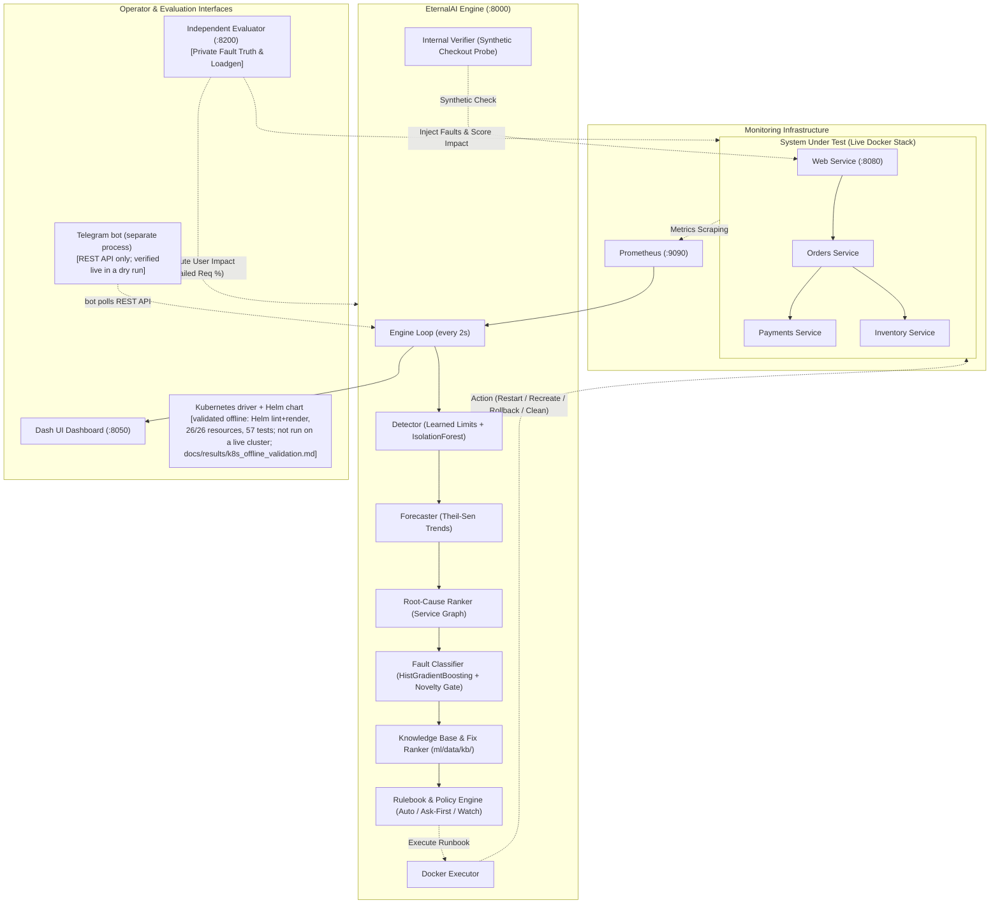

# EternalAI

A policy-governed operations and recovery assistant for backend microservices. Low-risk fixes run automatically; high-risk fixes need human approval. It detects anomalies, forecasts resource exhaustion, identifies root-cause services, executes allow-listed Docker runbooks under a rulebook, and verifies recovery with synthetic end-to-end checkouts.

The demo runs tag `demo-stable-1` (`49155ea`). Current numbers, with their conditions and sources: `docs/CURRENT_NUMBERS.md`.

## Headline Numbers (Current, Verified & Honest)

All numbers are produced by committed scripts from raw benchmark and test records under `docs/results/`. Read `docs/EVALUATION.md` for full methodologies and limitations.

| Metric | Result | Target / Baseline | Conditions & Scope | Source File | Status |
|---|---|---|---|---|---|
| **Disk Fill Warning Lead Time** | **86.4 s** (median) | >= 30 s | 5 warned runs [73.7s, 75.5s, 86.4s, 86.5s, 87.0s]; watch-only mode | `docs/results/forecast_check.md` | Verified live |
| **Memory Leak Warning Lead Time** | **18.3 s** (median) | >= 30 s | **FAILED TARGET**: 5 warned runs [8.1s, 9.8s, 18.3s, 19.1s, 34.5s]; steep fill slope before OOM | `docs/results/forecast_check.md` | Verified live (honest failure) |
| **Healthy-Run False Incidents** | **1 incident in 24 healthy runs** (v2) vs **6 / 24** for the `threshold_restart` baseline; **0 in 10** (v3) | <= 2 / 24 | v2 autopilot arm, 24 healthy runs (old policy); v3 unattended autopilot arm, 10 healthy runs (current policy) | `docs/results/benchmark_v2.md`, `docs/results/benchmark_v3_resume/20261024T150914-22eb30c0_combined.md` | Verified live |
| **Harmful Actions on Healthy Runs** | **0 / 24** (0%) | 0 / 24 | 0 actions executed in 24 autopilot and 8 ask-first healthy runs | `docs/results/benchmark_v2.md` | Verified live |
| **Supported Fault Recovery (Ask-First)** | **18 / 18** [82%, 100%] | >= 15 / 18 | v2 benchmark, old policy, approvals by a simulated operator after 5 s (no person reviewed); 3 runs each across 6 faults; verified by internal checkout. Current unattended v3: 10/30 recovered alone | `docs/results/benchmark_v2.md`, `docs/CURRENT_NUMBERS.md` | Verified live |
| **Supported Fault Recovery (Autopilot)** | **18 / 18** [82%, 100%] | >= 15 / 18 | v2 benchmark, old policy: no approvals, autopilot ran every action itself, including rollbacks and recreates; mean failed req 11.15%. Current unattended v3: 10/30 recovered alone | `docs/results/benchmark_v2.md`, `docs/CURRENT_NUMBERS.md` | Verified live |
| **Detection (v3, current policy)** | **30 / 30** supported faults detected, **12.57 s** mean | - | v3 unattended autopilot arm, 6 fault types × 5 seeds (600-649), candidate `71eb2f5`, `default.yaml` | `docs/results/benchmark_v3_resume/20261024T150914-22eb30c0_combined.md`, `docs/CURRENT_NUMBERS.md` | Verified live |
| **Wrong-service actions (v3)** | **0** | 0 | executed actions on a non-target service, 45 v3 autopilot runs | `docs/results/benchmark_v3_resume/20261024T150914-22eb30c0_combined.md` | Verified live |
| **Memory leak recovery (v3)** | failed requests **higher with EternalAI** (up to 5.0 %) than without (at most 0.3 %) | - | same 5 seeds, paired, v3 unattended autopilot vs no brain; so memory leak is not used as a live demo | `docs/results/benchmark_v3_resume/20261024T150914-22eb30c0_combined.md` | Verified live (honest failure) |
| **Live human approval** | rollback approved by a person in the dashboard (58.1 s) and by a Telegram tap (82.3 s); both verified recovered | - | demo rehearsal and dry run 1 on `demo-stable-1`, 300 s demo approval window; not a benchmark number | `docs/results/demo_rehearsal_20261024-1854.md`, `docs/results/dry_run_1_20261024-1948.md` | Verified live |
| **Unseen Fault Abstention (`cpu_burn`)** | **2 / 3** (v2) and **4 / 5** (v3) | >= 2 / 3 | v2 seed 426 restarted a wrong service, a standing limitation. A close-candidates abstain rule was added later; it was not triggered live, and its gate check (G4) failed on candidate `71eb2f5` | `docs/results/benchmark_v2.md`, `docs/postmortems/cpu_burn_seed426.md` | Verified live (rule: tests only) |
| **Cross-System Fault Transfer** | **0.385** (plan features) / **0.449** (live-computable features) macro-F1 | majority 0.132 (same averaging) | Train Ticket (53 real cases), real rows only, macro-F1 over the test classes; offline, not used by the demo. The unknown-fault threshold does not separate unknown faults reliably | `docs/results/dataset_a_classifier.md` | Offline result (NOT live) |
| **Live Classifier Grouped CV** | **0.991** macro-F1 | > 0.90 | forced-answer macro-F1 0.991 on 9,103 windows from 98 runs (offline grouped CV; data: 105 runs, 33,576 windows); in-distribution, optimistic; ECE = 0.003. This is the classifier the demo uses | `docs/results/models_cv_v2.md` | Offline CV |

## Architecture



## Quick start

```
git clone https://github.com/py007105/eAI && cd eAI
cp .env.example .env            # optional: GEMINI_API_KEY / GROQ_API_KEY; set ETERNALAI_APPROVAL_TOKEN to a real secret to enable Approve/Reject
docker compose --profile releases build
docker compose up -d
```

| what | where |
|---|---|
| dashboard | http://localhost:8050 |
| EternalAI API | http://localhost:8000 (`/status`, `/incidents`, `/approvals`) |
| the shop (web service) | http://localhost:8080 |
| evaluator (fault injection and scoring) | http://localhost:8200 |
| Prometheus / Jaeger | http://localhost:9090 / http://localhost:16686 |

Requires Docker with Compose. Python 3.11+ only for running the scripts and tests outside containers. Without an LLM key every report is a deterministic template report;
the system works the same. The approve, reject and mode endpoints are refused until `ETERNALAI_APPROVAL_TOKEN` is set to something other than the placeholder.
Stop everything with `docker compose down`.

## Limitations

> **Status: benchmark v1 and the reduced v2 evaluation are finished.** Every number in this repository comes from a script you can rerun and is written to a file under `docs/results/`. Read `docs/EVALUATION.md` (methods and limitations) before any number.

> **Three findings first (benchmark v1, `docs/results/benchmark.md`; not buried, not softened):**
> 1. **The ask-first arm is invalid.** The benchmark harness handed the brain and the simulated operator the placeholder token `change-me` (an import of the config module loaded it from `.env`), so the brain refused every approval (HTTP 503) and the operator ignored the refusal; the first proposal then sat unapproved and, because a pending approval never expires, blocked all later detection (42 of 45 runs). Its 0 of 30 recoveries say nothing about ask-first operation (`docs/postmortems/ask-first-arm-stuck-incident-v1.md`). Both faults are fixed on the v2 branch and evaluated on fresh seeds.
> 2. **False alarms on healthy runs.** The autopilot opened an incident in 8 of 10 healthy runs and recreated a container in 4 of 5 traffic surges (it called a surge a memory leak). threshold_restart had 5 of 10 false alerts and prototype_rules 8 of 10 (`docs/postmortems/autopilot-healthy-runs-v1.md`).
> 3. **Recovery is self-reported.** It comes from the system's own checkout; the independent measure is the load generator's failed-request %. No independent probe logs exist.
>
> Also true: the benchmark brains were configured without LLM keys (the report provider is not recorded per run), the pre-registered 20-run live forecast check (v3, `docs/results/forecast_check.md`) FAILED its memory-lead criterion (median lead 18.3 s against the 30 s target, warned in 5 of 5 runs) and passed for a gradual disk fill (median lead 86.4 s, 5 of 5), with 0 warnings in 10 healthy runs; its stated time-to-limit window held the actual time in 0 of 10 runs, and 27 of 30 autopilot runs reporting recovery is one application, five runs per cell, scripted faults. This box describes benchmark v1, which is kept unchanged; the v2 evaluation that followed is described below and in the canonical section of `docs/EVALUATION.md`.

Short form limitations (full list in `docs/EVALUATION.md`):
72 training runs, one application, scripted faults, laboratory public data, optimistic cross-validation scores, n = 5 per benchmark cell, recovery **self-reported** by the system's own checkout (the independent measure is the load generator's failed-request %), benchmark brains were configured without LLM keys but the per-run report provider is not recorded (design limitation), the Gemini path tried only a few times and Groq untested.

## What it does

1. **Observe**: Prometheus metrics, container state and logs of the four services (real FastAPI apps with real state, metrics and traces; versioned images so rollback is real).
2. **Detect**: per-service healthy-range limits and an IsolationForest on traffic-normalised features; a service that is not being scraped is treated as anomalous, never as normal.
3. **Diagnose**: a root-cause ranker over the service graph, a fault classifier with calibrated probability, and an explicit abstain path including a novelty gate for faults it has not seen.
4. **Act under policy**: three modes (watch-only, ask-first, autopilot), an allow-list of four real runbooks (restart, recreate, roll back to the previous release, clear an approved temp path),
   risk by target, cooldowns and a circuit breaker. Decisions are deterministic.
5. **Verify**: a synthetic checkout through web, orders, inventory and payments, held over a window. Only then is an incident marked recovered; otherwise it is partially recovered or unresolved.
6. **Escalate honestly**: on failure or abstention it preserves the evidence, stops repeated interventions and hands over.
7. **Report**: a Gemini (primary), Groq (secondary) or template report, constrained to a strict JSON schema. The model never writes or runs commands.

## Safety properties (each is enforced in code and covered by a test)

- Faults come from an independent evaluator; the ground truth lives in a volume the brain does not mount, and is revealed only after scoring.
- The LLM cannot act: its output is validated, evidence ids must exist, the runbook must be one the deterministic table allows for the diagnosed cause, and the engine's own diagnosis stays authoritative.
- Only implemented actions are exposed; nothing is simulated and presented as real.
- Splits for every model evaluation are by whole run, incident or system; preprocessing and thresholds are fitted on training folds only.
- Missing data stays missing; label-bearing fields are excluded from model inputs.

## Results

Benchmark v1, all five arms (all numbers from `docs/results/benchmark.md`):

| arm (v1) | self-reported recovery, 30 supported runs | failed-request % (mean) | seconds to self-reported recovery (mean) | healthy runs with a false alert (of 10) | harmful interventions on healthy runs |
|---|---|---|---|---|---|
| no_action | 0 | 32.17 | - | 0 | 0 |
| threshold_restart | 12 | 26.60 | 68.2 | 5 | 0 |
| prototype_rules | 9 | 26.29 | 69.4 | 8 | 0 |
| eternalai_ask_first (invalid, see finding 1) | 0 | 31.99 | - | 0 (detection blocked) | 0 |
| eternalai_autopilot | 27 | 18.39 | 50.0 | 8 | 4 |

Source (v1): `docs/results/benchmark.md`, sections 1b and 4 (rendered from `results/benchmark-v1/benchmark_raw.jsonl`). Where the autopilot does **not** beat the baselines: threshold_restart recovered `crash` in 4 of 5 runs against the autopilot's 2 of 5 (both orders crashes abstained); on `latency` the autopilot's failed-request % (8.1) is higher than threshold_restart's (4.0), and on `memory_leak` it is higher than no_action's (11.2 against 0.4) because its own container recreation fails requests; its false-alert count on healthy runs is worse than threshold_restart's and equal to prototype_rules'; and the pooled failed-request % and detection-time differences against threshold_restart and prototype_rules have intervals that include zero, so they are not distinguishable at n = 5 per cell.

<!-- gen:readme_v2 -->
## Benchmark v2 (final): fixes for the failures v1 exposed, tested on fresh seeds

v1 results above are kept unchanged. v2 is **not** presented as "the model is better": four things changed together (retrained models, memory features, approval-queue fix, telemetry condition T3), v1 and v2 are unpaired on different seeds, and v2 is a reduced plan. All caveats, exclusions and amendments are in one place: **`docs/EVALUATION.md`, section "Canonical methodology, results and limitations: benchmark v2"**. Tables: `docs/results/benchmark_v2.md`, `docs/results/benchmark_v1_v2.md`.

| v2 (seeds 200-318 and the replacement block 400-429) | observed | certainty |
|---|---|---|
| supported faults, autopilot: detected / recovered (own verification; v2 benchmark, old policy; current unattended v3: 10/30 recovered alone) | 18/18 [82%, 100%] / 18/18 [82%, 100%] | 18 runs, 3 per fault type; Wilson 95% interval lower bound about 82% |
| supported faults, ask-first (approvals by a simulated operator after 5 s (no person reviewed); v2 benchmark, old policy): detected / recovered | 18/18 [82%, 100%] / 18/18 [82%, 100%] | same sample sizes |
| healthy runs, autopilot: incidents opened / actions executed | 1/24 / 0/24 | upper bound of the interval for 1 in 24 is about 20% |
| healthy runs, threshold_restart on the same seeds: incidents opened | 6/24 | |
| unseen fault cpu_burn, autopilot: abstained | 2/3 (v1: 4/5, other seeds, not pooled) | seed 426 restarted the wrong service (post-mortem in `docs/postmortems/cpu_burn_seed426.md`) |
| mean failed-request %, 18 supported autopilot runs | 11.15 | independent impact metric, no same-seed no-action reference in v2 |

The evaluated set has 95 rows: 58 valid original rows and 37 replacement rows run after the inventory stock ran out (the replacement runs were designed after the problem was seen; 2 reused seeds, 35 used fresh seeds). There is **no paired v2 baseline comparison for supported faults**, the forecast's memory-lead check FAILED (median 18.3 s vs 30 s; disk passed, median 86.4 s) and Groq is untested.
<!-- /gen:readme_v2 -->

See also:

- `docs/EVALUATION.md` (methods, limitations, how to reproduce) and `docs/EVALUATION_PLAN.md` (the benchmark rules, fixed before results)
- `docs/results/` (generated tables: public-dataset, own-application and cross-system results are kept separate; `benchmark.md` is the v1 benchmark; `forecast_check.md` is the v3 forecast check: memory lead FAILED, disk PASSED)
- `docs/MODEL_CARD.md`, `docs/DATA.md`, `docs/DATA_QUALITY.md`, `docs/postmortems/`

## Repository layout

```
eAI/
├── engine/        the brain: features, detection, classification, ranking, forecast, policy,
│                  executor, verification, LLM reports, API (Python package `engine`)
│   ├── kb/            knowledge base loader and outcome-ranked fix choice
│   ├── notify/        Telegram notifier and approval bot
│   └── rulebooks/     policy rulebooks (default.yaml)
├── services/
│   ├── shop/          the four protected services: web, orders, payments, inventory
│   └── loadgen/       steady traffic generator
├── evaluator/     fault injection, truth records and scoring
├── dashboard/     operator dashboard (Dash; English and Hindi labels)
├── console/       read-only web console (React + Vite)
├── ml/
│   ├── models/        training, evaluation and frozen artifacts (ml/models/artifacts)
│   └── data/          data scripts and the knowledge base (ml/data/kb)
├── deploy/
│   └── telemetry/     Prometheus configuration (Kubernetes manifests join here)
├── tools/         benchmark, live-check, release, rendering and debugging scripts
├── tests/         unit and regression tests (pytest)
├── docs/          architecture, evaluation, demo, pitch, results, postmortems
├── results/       raw evidence from benchmark and live runs
└── docker-compose.yml, docker-compose.llm.yml   start the stack from the repository root
```

Who owns which folder and how to contribute: `CONTRIBUTING.md` and `.github/CODEOWNERS`. Old-to-new paths: `docs/STRUCTURE.md`.

## Credits and licences

MIT licence (`LICENSE`). Patterns, not code, were taken from the reference projects listed in `docs/REFERENCES.md`; attributions and data licences are in `NOTICE`.
