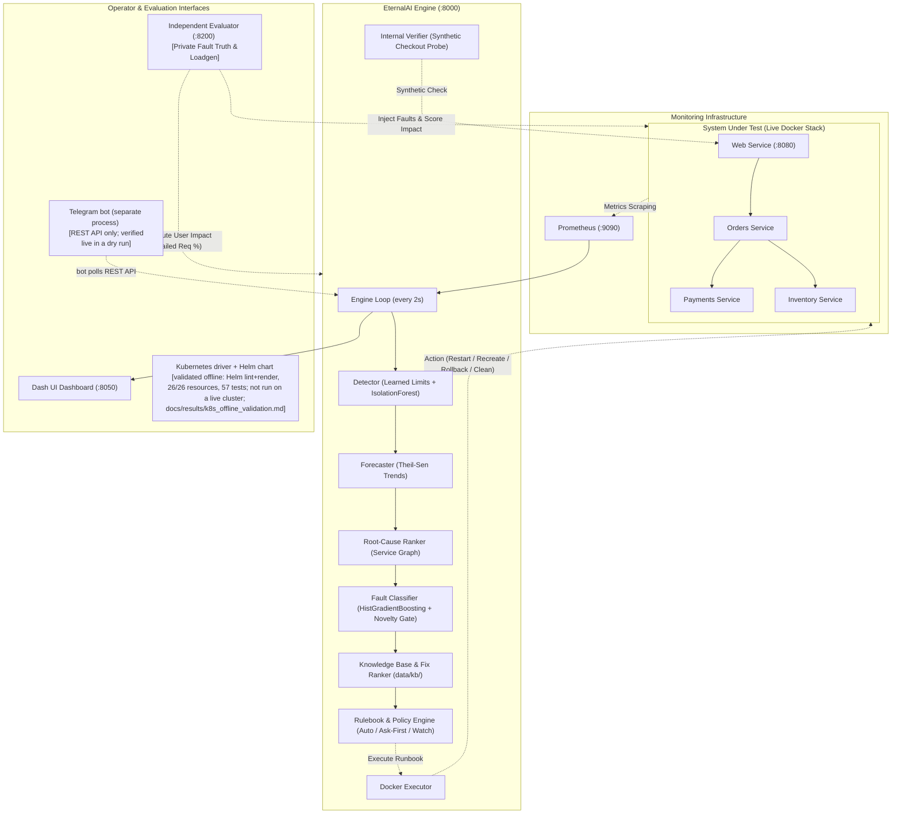

# EternalAI: Pitch Document

A policy-governed operations and recovery assistant for backend services: low-risk fixes run automatically; high-risk fixes need human approval.

The demo runs tag `demo-stable-1` (`49155ea`). Every number here is taken from `docs/CURRENT_NUMBERS.md`, which also gives its conditions.

---

## 1. The Problem (in 3 lines)

1. Backend microservices fail unpredictably from resource exhaustion, bad deployments, configuration errors, and cascading dependencies.
2. Alert storms flood on-call engineers with symptom alarms, obscuring which service actually triggered the failure.
3. Manual triage and remediation are slow, stressful, and error-prone, costing engineering hours and causing customer downtime.

---

## 2. The Solution (in 5 lines)

1. **Observe & Detect**: Scrapes 8 health telemetry signals per service every 2 s, detecting anomalies against learned per-service healthy boundaries and IsolationForest boundaries.
2. **Predict & Trace Root Cause**: Forecasts resource saturation trends (Theil-Sen) ahead of exhaustion limits and ranks the root-cause service across the call dependency graph.
3. **Identify & Select Fix**: Classifies fault types using calibrated gradient boosting with an explicit novelty gate that abstains on unfamiliar faults, mapping to an outcome-ranked knowledge base.
4. **Enforce Policy & Act**: Executes only through deterministic policy modes (watch-only, ask-first, autopilot) constrained to four audited Docker runbooks.
5. **Verify & Escalate**: Validates end-to-end recovery using synthetic four-service checkouts over an observation window, escalating cleanly with preserved evidence if recovery fails.

---

## 3. Architecture: What Runs Today

---

## 4. Live Today vs Roadmap

| Capability | Live Today (Verified on Stack) | Roadmap (Branches / Future) |
|---|---|---|
| **Runtime Environment** | Docker Compose (4 services: web, orders, payments, inventory) | Kubernetes (`team/k8s-rajat`): validated offline (Helm lint+render, 26/26 resources schema-valid, 57 tests incl. restart/rollback/scale); not run on a live cluster (`docs/results/k8s_offline_validation.md`) |
| **Telemetry Ingestion** | Prometheus metrics every 2 s + Docker container state | OpenTelemetry collector + service-mesh traces |
| **Detection** | Per-service learned limits + IsolationForest | Dynamic seasonal baselines |
| **Forecasting** | Live Theil-Sen slope forecaster (disk fill & memory leak) | Multi-variate LSTM / Prophet for periodic seasonal spikes |
| **Root-Cause Analysis** | Service graph topological ranker + gradient-boosted ranker | Full causal DAG learning on dynamic distributed traces |
| **Fault Classification** | Calibrated gradient boosting (6 live classes + novelty gate) | Continuous active learning on production incidents |
| **Fix Actions** | 4 audited Docker runbooks (restart, recreate, rollback, temp clean) | Kubernetes rolling restart, HPA horizontal scaling, pod migration |
| **Safety Governance** | Deterministic rulebook (cooldowns, circuit breaker, ask-first token) | RBAC-partitioned namespaces, multi-party approver quorums |
| **Verification** | Internal 4-service synthetic checkout pass over observation window | Independent evaluator-side e2e probe with audit traces |
| **Notifications** | Dash UI live incident views + REST API; Telegram approval via a separate bot over the REST API, verified live in a dry run (a real tap approved a rollback) | Telegram merged into the release build |

---

## 5. Headline Numbers (Current, Honest, with Conditions)

All numbers are backed by executable scripts and generated result files in the repository:

| Metric | Result | Target / Baseline | Conditions & Scope | Source File | Status |
|---|---|---|---|---|---|
| **Disk Fill Warning Lead Time** | **86.4 s** (median) | >= 30 s | 5 warned runs [73.7s, 75.5s, 86.4s, 86.5s, 87.0s]; watch-only mode | `docs/results/forecast_check.md` | **Verified live** |
| **Memory Leak Warning Lead Time** | **18.3 s** (median) | >= 30 s | **FAILED TARGET**: 5 warned runs [8.1s, 9.8s, 18.3s, 19.1s, 34.5s]; leak slope steep before OOM limit | `docs/results/forecast_check.md` | **Verified live (honest failure)** |
| **Healthy-Run False Incidents** | **1 incident in 24 healthy runs** (v2) vs **6 / 24** for the `threshold_restart` baseline; **0 in 10** (v3) | <= 2 / 24 | v2 autopilot arm, 24 healthy runs (seeds 200-318, 400-429; old policy); v3 unattended autopilot arm, 10 healthy runs (current policy) | `docs/results/benchmark_v2.md`, `docs/results/benchmark_v3_resume/20261024T150914-22eb30c0_combined.md` | **Verified live** |
| **Harmful Actions on Healthy Runs** | **0 / 24** (0%) | 0 / 24 | 0 executed actions across 24 autopilot and 8 ask-first healthy runs | `docs/results/benchmark_v2.md` | **Verified live** |
| **Supported Fault Recovery (Ask-First)** | **18 / 18** [82%, 100%] | >= 15 / 18 | v2 benchmark, old policy, approvals by a simulated operator after 5 s (no person reviewed); 3 runs each across 6 faults; verified by internal synthetic checkout. Current unattended v3: 10/30 recovered alone | `docs/results/benchmark_v2.md`, `docs/CURRENT_NUMBERS.md` | **Verified live** |
| **Supported Fault Recovery (Autopilot)** | **18 / 18** [82%, 100%] | >= 15 / 18 | v2 benchmark, old policy: no approvals, autopilot ran every action itself, including rollbacks and recreates; mean failed requests 11.15%. Current unattended v3: 10/30 recovered alone | `docs/results/benchmark_v2.md`, `docs/CURRENT_NUMBERS.md` | **Verified live** |
| **Live human approval** | rollback approved by a person in the dashboard (58.1 s) and by a Telegram tap (82.3 s); both verified recovered | - | demo rehearsal and dry run 1 on `demo-stable-1`, 300 s demo approval window; not a benchmark number | `docs/results/demo_rehearsal_20261024-1854.md`, `docs/results/dry_run_1_20261024-1948.md` | **Verified live** |
| **Unseen Fault Abstention (`cpu_burn`)** | **2 / 3** (v2) and **4 / 5** (v3) | >= 2 / 3 | v2 seed 426 restarted a wrong service (`inventory`), a standing limitation. A close-candidates abstain rule was added later; it was not triggered live, and its gate check (G4) failed on candidate `71eb2f5` | `docs/results/benchmark_v2.md`, `docs/postmortems/cpu_burn_seed426.md` | **Verified live (rule: tests only)** |
| **Cross-System Fault Transfer (Unseen System)** | **0.385** (plan features) / **0.449** (live-computable features) macro-F1 | majority 0.132 (same averaging) | Train Ticket (53 real cases), real rows only, macro-F1 over the test classes; offline, not used by the demo. The unknown-fault threshold does not separate unknown faults reliably | `docs/results/dataset_a_classifier.md` | **Offline result** |
| **Live Classifier Grouped CV** | **0.991** macro-F1 | > 0.90 | offline grouped cross-validation on this application's own 105 runs (33,576 windows); in-distribution, optimistic; ECE = 0.003. This is the classifier the demo uses | `docs/results/models_cv_v2.md` | **Offline CV** |

---

## 6. Team and Roles

**Team Brahmastra** (Hackyard Build 2026, IIT Guwahati):
- **Mihir Pukale** (Track Lead): Knowledge base review and outcome ranking validation, offline ML evaluation and cross-system transfer report, pitch pack and technical documentation.
- **Rajat Raghatwan**: Kubernetes driver abstraction layer, Helm chart packaging and a kind end-to-end script (validated offline; not run on a live cluster).
- **Sanskar Randive**: Telegram bot integration with interactive approval flows, Dash UI dashboard UX improvements, and notification dispatching.
